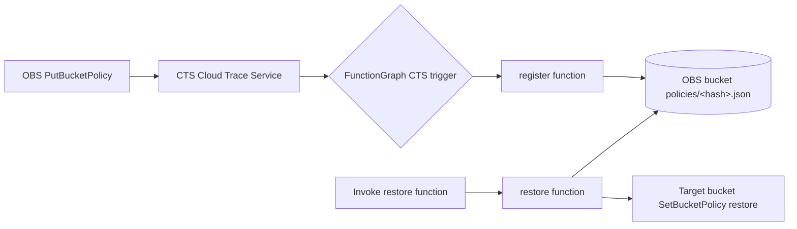

# lean-governance-obs-policy-audit


> A best practice for "OBS bucket policy auditing and one-click restore" built on native Huawei Cloud Serverless services.
> Whenever any OBS bucket in the account has a bucket policy set (PutBucketPolicy), the policy snapshot is automatically recorded to OBS;
> when needed, a historical policy can be restored to the target bucket in one click using the policy hash.

## 1. Overview

A bucket policy is a single-value overwrite configuration; after an accidental or malicious change it is hard to roll back, and there is no central audit of "who changed what and when". This practice uses **OBS + FunctionGraph + CTS trigger + IAM agency** to build a lightweight, resource-efficient automation mechanism:

- **Register**: once an OBS bucket policy is set, a snapshot is automatically recorded (keyed by the md5 hash, giving natural de-duplication and traceability).
- **Restore**: with a policy hash, a historical policy can be restored to the target bucket in one click.

It suits operations and security scenarios that need bucket policy compliance auditing and fast rollback. It is pure Serverless by default, with no reserved cluster.

## 2. Table of Contents

- [1. Overview](#1-overview)
- [2. Table of Contents](#2-table-of-contents)
- [3. Architecture Diagram](#3-architecture-diagram)
- [4. Highlights](#4-highlights)
- [5. Cloud Services Used](#5-cloud-services-used)
- [6. Prerequisites](#6-prerequisites)
- [7. Quick Start](#7-quick-start)
- [8. Step-by-Step Deployment](#8-step-by-step-deployment)
- [9. Usage / Verification](#9-usage--verification)
- [10. Cleanup](#10-cleanup)
- [11. Detailed Explanation](#11-detailed-explanation)
- [12. Dependencies](#12-dependencies)
- [13. FAQ / Troubleshooting](#13-faq--troubleshooting)
- [14. Contributing](#14-contributing)
- [15. License](#15-license)
- [16. Contact / Maintainers](#16-contact--maintainers)

## 3. Architecture Diagram



## 4. Highlights

- **Pure Serverless**: no reserved cluster; FunctionGraph does not run without invocations, OBS is used on demand, no resources reserved
- **Traceable**: every bucket policy snapshot carries a timestamp and operator identity, supporting listing of history by bucket
- **One-click restore**: precise restore by md5 hash, avoiding rebuilding a policy from memory
- **IaC-based**: one-click deployment with Terraform + the huaweicloud Provider; resources can be version-controlled

## 5. Cloud Services Used

| Service | Purpose | Notes |
|---|---|---|
| OBS | Bucket policy snapshot storage | `policies/<md5>.json` prefix |
| FunctionGraph | register / restore functions | Triggered by CTS / manual invocation |
| CTS | Audit event source (PutBucketPolicy) | Triggers FunctionGraph |
| IAM agency | Temporary credentials for functions to access OBS | Includes policies such as OBS Administrator |
| SMN (optional alternative) | CTS notification bridge | Alternative link in some regions |

> **Note**: all services can be created with one click through this repository's Terraform; for cleanup, see [Section 10 Cleanup](#10-cleanup).

## 6. Prerequisites

- A Huawei Cloud account with permissions to create OBS, FunctionGraph, and IAM agencies.
- Local installation: Terraform >= 1.5, Python 3.9+, pip3, zip, obsutil.
- Configure access credentials (environment variables only, do not write to files):
```bash
export HW_ACCESS_KEY="<HW_ACCESS_KEY>"
export HW_SECRET_KEY="<HW_SECRET_KEY>"
export HW_REGION_NAME="cn-north-4"
```
- Change `store_bucket_name` in `infra/variables.tf` to a **globally unique** bucket name.

## 7. Quick Start

```bash
# 1) Initialize (automatically pulls the huaweicloud provider)
cd infra && terraform init

# 2) Preview resources
terraform plan

# 3) Package and upload function code to OBS (see src/functions/build.sh)
cd ../src/functions && STORE_BUCKET=<your-bucket-name> ./build.sh upload

# 4) Deploy
cd ../../infra && terraform apply
```

## 8. Step-by-Step Deployment

1. `terraform init` — initialize the backend and providers (see Quick Start above).
2. `terraform plan` — confirm that 6 resources will be created (OBS bucket, bucket policy, agency, 2 functions, CTS trigger).
3. Package the function: `cd src/functions && ./build.sh upload` (you must first `pip install` dependencies and upload the zip with `obsutil`).
4. `terraform apply` — create the resources; outputs the storage bucket name, the two function URNs, and the agency name.

## 9. Usage / Verification

```bash
# Set a bucket policy on a test bucket and observe whether it is automatically recorded
obsutil put-bucket-policy obs://<test-bucket> -policy=<policy.json>

# List policy snapshots (a <md5>.json should appear)
obsutil ls obs://<STORE_BUCKET>/policies/ -s

# Manually invoke the restore function to restore (event body {"BucketPolicyHash":"<md5>"})
# In the console "Functions → restore → Test" paste this JSON, or invoke synchronously via the FunctionGraph SDK
```

Expected: register returns `{"status":"recorded",...}`; restore returns `{"message":"bucket policy restored: <md5> -> <bucket-name>",...}`.

After deployment, follow these steps to verify that the business functionality works before considering the delivery complete.

## 10. Cleanup

```bash
cd infra && terraform destroy
# OBS has multi-versioning enabled; before destroy it is recommended to empty all versions and delete markers to avoid residuals:
obsutil rm obs://<STORE_BUCKET> -r -f -allversions
```

## 11. Detailed Explanation

- **Event chain**: OBS PutBucketPolicy → recorded by CTS → FunctionGraph CTS trigger `operations=["OBS:bucket:setBucketPolicy"]` → register function writes an OBS snapshot.
- **Data model**: snapshots are saved as objects `policies/<md5>.json`, containing `bucket_name / timestamp / user_identity / bucket_policy / bucket_policy_hash`; list by bucket name and filter to obtain the snapshot list.
- **Permission essentials**: the OBS data plane only honors bucket policies; the storage bucket policy explicitly grants the agency principal; `OBS Administrator` is a domain-level role and must use `domain_roles`; function temporary credentials are injected via `context`.
- **Region note**: CTS triggers for global-level services such as OBS may only work in certain regions; if it does not work, use the alternative "CTS notification → SMN → FunctionGraph (SMN trigger)" link (commented block in `infra/main.tf`).

See `docs/architecture.md` and `docs/deployment-guide.md`.

## 12. Dependencies

- The function depends on [`esdk-obs-python`](https://pypi.org/project/esdk-obs-python/) (Huawei Cloud OBS Python SDK).
- Architecture design reference: a practice for multi-version snapshotting and restoring of OBS bucket policies.

## 13. FAQ / Troubleshooting

- **register not triggered?** Usually a region restriction (see Region note above); switch to the SMN bridge link.
- **restore returns 403?** When the target bucket already has a bucket policy, you must add an Allow for PutBucketPolicy to this agency in its bucket policy.
- **Function reports it cannot find esdk-obs-python?** You did not run `build.sh` to package dependencies, or the code_url path does not match the upload path.

## 14. Contributing

Please submit feedback and improvement suggestions through Issues; this repository does not accept direct PRs, and all changes are reviewed by the maintainers before merging.

## 15. License

This practice is licensed under **MIT No Attribution**; see the repository root [`LICENSE`](LICENSE) file.

This practice is released under the MIT-0 license. See [LICENSE](LICENSE).

## 16. Contact / Maintainers
| Item | Content |
|---|---|
| **Creator** | [dgc-git](https://github.com/dgc-git) |
| **Maintainer** | [dgc-git](https://github.com/dgc-git) |
| **Contact** | GitHub Issues / PR (see [Section 14](#14-contributing)) |
