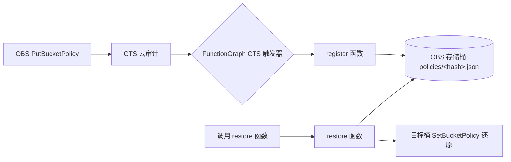

# lean-governance-obs-policy-audit · OBS 桶策略版本化（Serverless）


> 基于华为云原生 Serverless 服务的「OBS 桶策略留痕与一键还原」最佳实践。
> 每当账号内任意 OBS 桶被设置桶策略（PutBucketPolicy）时，自动把该策略快照记录到 OBS；
> 需要时可凭策略哈希一键还原历史策略到目标桶。

## 1. 简介 / Overview

### 简介


桶策略是单值覆盖式配置，误改或恶意篡改后难以回退，也缺乏「谁、何时、改成了什么」的集中审计。
本实践用 **OBS + FunctionGraph + CTS 触发器 + IAM 委托** 搭建一套轻量、低成本的自动化机制：

- **记录（register）**：OBS 桶策略一旦被设置，自动留痕（md5 哈希为键，天然去重/可追溯）。
- **还原（restore）**：凭策略哈希，一键把历史策略还原到目标桶。

适用于需要桶策略合规审计、快速回退的运维与安全场景；默认纯 Serverless，无预留集群。

---

## 2. 目录


- [1. 简介 / Overview](#1-简介--overview)
- [2. 目录](#2-目录)
- [3. 架构图](#3-架构图)
- [4. 方案亮点](#4-方案亮点)
- [5. 涉及云服务](#5-涉及云服务)
- [6. 前置条件](#6-前置条件)
- [7. 快速开始](#7-快速开始)
- [8. 分步部署](#8-分步部署)
- [9. 使用方法 / 验证](#9-使用方法--验证)
- [10. 清理资源](#10-清理资源)
- [11. 详细说明](#11-详细说明)
- [12. 依赖](#12-依赖)
- [13. FAQ / 故障排除](#13-faq--故障排除)
- [14. 贡献指南](#14-贡献指南)
- [15. 许可证](#15-许可证)
- [16. 联系方式 / 维护者](#16-联系方式--维护者)

---

## 3. 架构图



---

## 4. 方案亮点

- **纯 Serverless**：无预留集群，FunctionGraph 无调用不运行，OBS 按量使用，无需预留资源。
- **可追溯**：每条桶策略快照带时间戳与操作者身份，支持按桶列举历史。
- **一键还原**：凭 md5 哈希精确还原，避免凭记忆重建策略。
- **IaC 化**：Terraform + huaweicloud Provider 一键部署，资源可版本化管理。

---

## 5. 涉及云服务

| 服务 | 用途 | 备注 |
|---|---|---|
| OBS | 桶策略快照存储 | policies/<md5>.json 前缀 |
| FunctionGraph | register / restore 函数 | 由 CTS / 手动调用触发 |
| CTS | 审计事件源（PutBucketPolicy） | 触发 FunctionGraph |
| IAM 委托 | 函数访问 OBS 的临时凭证 | 含 OBS Administrator 等策略 |
| SMN（可选备选） | CTS 通知桥接 | 部分区域替代链路 |

> **提示**：所有服务均可通过本仓库的 Terraform 一键创建；如需清理，请参见 [第 10 节「清理资源」](#10-清理资源)。

---

## 6. 前置条件

- 华为云账号，具备创建 OBS / FunctionGraph / IAM 委托权限。
- 本地安装：Terraform >= 1.5、Python 3.9+、pip3、zip、obsutil。
- 配置访问凭证（**仅环境变量，禁止写入文件**）：
```bash
export HW_ACCESS_KEY="<HW_ACCESS_KEY>"
export HW_SECRET_KEY="<HW_SECRET_KEY>"
export HW_REGION_NAME="cn-north-4"
```
- 修改 `infra/variables.tf` 的 `store_bucket_name` 为**全局唯一**桶名。

---

## 7. 快速开始

```bash
# 1) 初始化（自动拉取 huaweicloud provider）
cd infra && terraform init

# 2) 预览资源
terraform plan

# 3) 打包并上传函数代码到 OBS（见 src/functions/build.sh）
cd ../src/functions && STORE_BUCKET=<你的桶名> ./build.sh upload

# 4) 部署
cd ../../infra && terraform apply
```

---

## 8. 分步部署

1. `terraform init` —— 初始化后端与 provider（见上方快速开始）。
2. `terraform plan` —— 确认将创建 6 个资源（OBS 桶、桶策略、委托、2 函数、CTS 触发器）。
3. 打包函数：`cd src/functions && ./build.sh upload`（需先 `pip install` 依赖并 `obsutil` 上传 zip）。
4. `terraform apply` —— 创建资源；输出存储桶名、两个函数 URN、委托名。

---

## 9. 使用方法 / 验证

### 使用方法与验证


```bash
# 给测试桶设置桶策略，观察是否被自动记录
obsutil put-bucket-policy obs://<测试桶> -policy=<policy.json>

# 列出策略快照（应出现 <md5>.json）
obsutil ls obs://<STORE_BUCKET>/policies/ -s

# 手动调用 restore 函数还原（事件体 {"BucketPolicyHash":"<md5>"}）
# 控制台「函数 → restore → 测试」粘贴该 JSON，或 FunctionGraph SDK 同步调用
```

预期：register 返回 `{"status":"recorded",...}`；restore 返回 `{"message":"桶策略已还原: <md5> -> <桶名>",...}`。

---

## 10. 清理资源

```bash
cd infra && terraform destroy
# OBS 开启多版本，destroy 前建议清空所有版本与删除标记避免残留：
obsutil rm obs://<STORE_BUCKET> -r -f -allversions
```

---

## 11. 详细说明

- **事件链路**：OBS PutBucketPolicy → CTS 记录 → FunctionGraph CTS 触发器
`operations=["OBS:bucket:setBucketPolicy"]` → register 函数写 OBS 快照。
- **数据模型**：快照以对象 `policies/<md5>.json` 保存，内容含 `bucket_name / timestamp /
user_identity / bucket_policy / bucket_policy_hash`；按桶名列举 + 过滤获取快照列表。
- **权限要点**：OBS 数据面只认桶策略，已在存储桶策略显式授权委托主体；
`OBS Administrator` 为 domain 级角色须用 `domain_roles`；函数临时凭证经 `context` 注入。
- **区域注意**：CTS 触发器对 OBS 等全局级服务在部分区域可能仅特定区域可触发
不生效时改用「CTS 通知 → SMN → FunctionGraph(SMN 触发器)」备选链路（`infra/main.tf` 注释块）。

详见 `docs/architecture.md`、`docs/deployment-guide.md`。

---

## 12. 依赖

- 函数依赖 [`esdk-obs-python`](https://pypi.org/project/esdk-obs-python/)（华为云 OBS Python SDK）。
- 架构设计参考：OBS 桶策略多版本快照与恢复的实践方案。

---

## 13. FAQ / 故障排除

- **register 没被触发？** 多为区域限制（见上方区域注意），切换 SMN 桥接链路。
- **restore 返回 403？** 目标桶已有桶策略时，需在其桶策略中加入对本委托的 PutBucketPolicy 允许。
- **函数报错找不到 esdk-obs-python？** 未执行 `build.sh` 打包依赖，或 code_url 路径与上传路径不一致。

---

## 14. 贡献指南

请通过 Issue 提交反馈与改进建议；本仓库不接受直接 PR，统一由维护者评审后合入。

---

## 15. 许可证

本实践采用 **MIT No Attribution** 许可证，详见仓库根目录 [`LICENSE`](LICENSE) 文件。


本实践以 MIT-0 许可证发布。详见 [LICENSE](LICENSE)。

---

## 16. 联系方式 / 维护者
| 项 | 内容 |
|---|---|
| **创建者** | [dgc-git](https://github.com/dgc-git) |
| **维护者** | [dgc-git](https://github.com/dgc-git) |
| **联系方式** | GitHub Issues / PR（见[第 14 节](#14-贡献指南)） |
