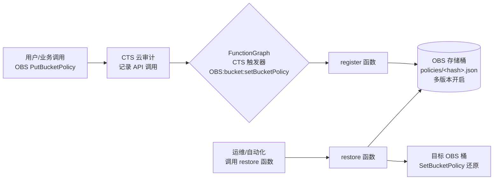

# OBS 桶策略版本化 —— 架构说明

> 一套基于华为云原生 Serverless 服务的「OBS 桶策略留痕与还原」最佳实践。
> 每当账号内任意 OBS 桶被设置桶策略（PutBucketPolicy）时，自动把该策略快照记录到
> OBS 存储桶；需要时可凭策略哈希一键还原历史策略到目标桶。

## 1. 解决的问题

- **桶策略无版本**：OBS 桶策略是单值覆盖式配置，误改/恶意改后难以回退。
- **合规留痕**：谁、在何时、把哪个桶的策略改成了什么，缺乏集中审计记录。
- **快速还原**：出问题时能按哈希精确还原到某一历史版本，而非凭记忆重建。

## 2. 架构图



## 3. 组件与职责

| 组件 | 华为云服务 | 职责 |
|-|-|-|
| 存储桶 | OBS（`policy_store`） | 以对象形式保存每条桶策略快照，对象键 `policies/<md5>.json`；开启多版本防误删 |
| 记录函数 | FunctionGraph `register` | CTS 触发，解析 PutBucketPolicy 事件，写快照到 OBS |
| 还原函数 | FunctionGraph `restore` | 手动/API 调用，按哈希读取快照并 SetBucketPolicy 还原 |
| 触发器 | FunctionGraph CTS 触发器 | 按 `OBS:bucket:setBucketPolicy` 精准触发 |
| 委托 | IAM 委托（`fgs-agency`） | 授予函数 `OBS Administrator`，运行期以临时凭证访问 OBS |
| 桶策略 | OBS 桶策略 | 显式授权委托主体对存储桶的读写（OBS 数据面只认桶策略） |

## 4. 数据模型

快照以 OBS 对象保存，每条记录包含以下字段：`{BucketName, Timestamp, BucketPolicy, BucketPolicyHash, UserIdentity}`

- **主键 / 查询**：对象键 `policies/<BucketPolicyHash>.json`（md5 即天然主键，去重且可追溯）。
- **按桶名查询**：列举 `policies/` 前缀并按对象内容中的 `bucket_name` 过滤实现
适合审计与「某桶的历史策略列表」场景。
- **对象内容**（JSON）：
```json
{
"bucket_name": "example-bucket",
"timestamp": "2026-08-10T07:00:00Z",
"user_identity": "{...}",
"bucket_policy": "<OBS 桶策略 JSON 字符串>",
"bucket_policy_hash": "<md5>"
}
```

## 5. 事件订阅配置

| 配置项 | 取值 | 说明 |
|-|-|-|
| service_type | OBS | 事件源为桶策略服务 |
| 事件类型 | 云 API Call via 云审计 | CTS 触发器自动包裹 `event["cts"]` |
| operations | `["OBS:bucket:setBucketPolicy"]` | 匹配 setBucketPolicy 操作 |

CTS 触发器交付给函数的事件结构（节选）：
```json
{
"cts": {
"time": "2026-08-10T07:00:00Z",
"user": { "name": "...", "id": "...", "domain": { "name": "...", "id": "..." } },
"service_type": "OBS",
"resource_type": "bucket",
"trace_name": "setBucketPolicy",
"request": { "bucket_name": "example-bucket", "bucket_policy": "{...}" }
}
}
```

## 6. 设计取舍

- **存储选型**：选用 OBS 对象存储，保持纯 Serverless、按用量计费，与「按需、无预留容量」目标一致。
- **区域注意**：CTS 触发器对 OBS 这类全局级服务，在部分区域可能仅特定区域可触发；
若目标区域不生效，启用「CTS 关键事件通知 → SMN → FunctionGraph(SMN 触发器)」备选链路
（见 `infra/main.tf` 注释块与部署指南）。
